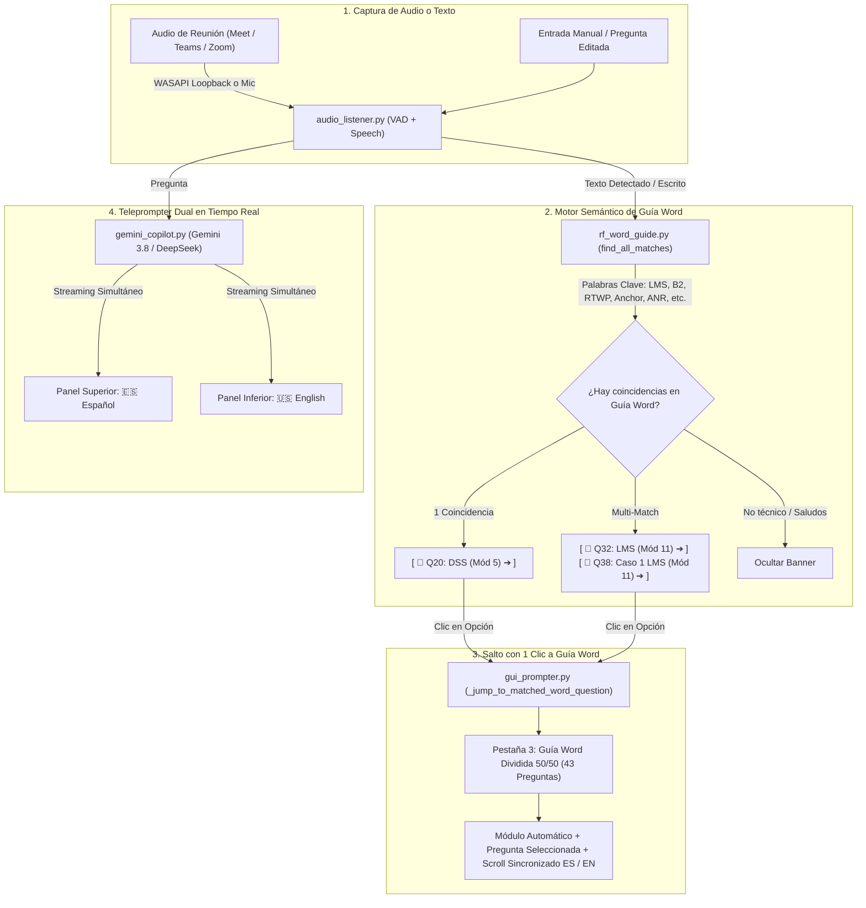

# 🎙️ Copiloto de Entrevistas en Tiempo Real (Gemini 3.8 Flash)

[](https://www.python.org/)
[](https://aistudio.google.com/)
[](LICENSE)
[](https://microsoft.com/windows)

Un copiloto y teleprompter inteligente de escritorio diseñado para escuchar en vivo las preguntas de un entrevistador durante una reunión virtual (**Google Meet, Microsoft Teams, Zoom, Skype, Discord, etc.**) y generar respuestas estructuradas, precisas y de alto nivel técnico al instante mediante el SDK oficial de **Google Gemini 3.8 Flash**, con soporte multi-motor (**DeepSeek** y **OpenRouter**).

Especializado en **Senior RF Optimization & Performance Engineer (Ericsson 4G/5G)**, integrando la Guía Oficial de Entrevista (**12 Módulos / 43 Preguntas maestras**) con sincronización bilingüe en paralelo (Español / Inglés) y cobertura completa de **LMS, Movilidad 5G NSA / EN-DC, KPIs, Features Ericsson, Troubleshooting de PIM/RTWP, Automatización con Python/SQL y 3 Casos Prácticos Reales (Noviembre 2022 – Octubre 2026)**.

---

## 🌟 Características Destacadas

### 1. 📖 Vinculación Inteligente en Vivo Copiloto ➔ Guía Word (Multi-Coincidencias)
- **Detección Automática por Palabras Clave**: Cuando el copiloto escucha una pregunta o cuando escribes en la caja de preguntas o en la barra manual, el motor semántico analiza los conceptos técnicos en tiempo real (`<KeyRelease>`).
- **Soporte de Términos Individuales**: Reconoce palabras clave técnicas individuales sin exigir frases exactas completas (por ejemplo: `LMS`, `layer management`, `traffic steering`, `anchor selection`, `spectral efficiency`, `ANR`, `RS power`, `caso 1`, `caso 2`, `caso 3`, `dynamic`, `B2`, `RTWP`, `handover`, `A3`, `PRACH`, `carrier aggregation`, `5G`, `MIMO`, etc.).
- **Múltiples Posibilidades Interactivas (Multi-Match)**:
  - Si un término técnico abarca varios tópicos (por ejemplo, `B2` aplica para **Eventos de Handover B1/B2** en el Módulo 3 y para **Carrier Aggregation con Banda 2** en el Módulo 5, o `LMS` aplica para la pregunta teórica Q32 y el Caso Práctico Q38), el copiloto presenta **todas las opciones detectadas como botones interactivos directos**.
  - Ejemplo visual:
    ```
    📖 COINCIDENCIAS EN GUÍA WORD (2 POSIBILIDADES ENCONTRADAS):
    [ 📖 Q32: LMS – Layer Management Strategy (Mód 11) ➔ ]   [ 📖 Q38: Experiencia Práctica – Caso 1 LMS (Mód 11) ➔ ]
    ```
- **Navegación Instantánea con 1 Clic (`_jump_to_matched_word_question`)**:
  - Al hacer clic en cualquiera de los botones/chips, la interfaz se traslada automáticamente a la **Pestaña 3 (Guía Word)**.
  - Selecciona de forma autónoma el módulo correspondiente en el selector.
  - Resalta y enfoca la pregunta exacta en el índice lateral.
  - Carga y posiciona ambas hojas (Español e Inglés) desde el inicio para lectura inmediata.

---

### 2. ⚡ Teleprompter Dual Dividido Horizontalmente (🇪🇸 Español Arriba / 🇺🇸 Inglés Abajo)
- **Pantalla Superior**: Muestra la respuesta directa y sintetizada en **Español** (`🇪🇸`), lista para leer en voz alta de inmediato con viñetas técnicas, parámetros y casos reales.
- **Pantalla Inferior**: Muestra simultáneamente la respuesta correspondiente en **Inglés** (`🇺🇸`), ideal para entrevistas bilingües, clientes internacionales o videollamadas técnicas.
- **Generación Simultánea en Vivo**: Los motores de IA generan y transmiten en tiempo real ambos bloques de idioma en streaming token a token.
- **Caja de Pregunta Limpia y 100% Editable**: Recuadro de pregunta vacío y listo para editar al instante (sin textos de placeholder molestos que haya que borrar manualmente).
- **Acciones Rápidas Ergonómicas Reubicadas**: Botones `🗑️ Limpiar`, `📜 Historial`, `📋 Copiar ES`, `📋 Copiar EN` y `📋 Copiar Ambos` situados estratégicamente debajo de la pregunta para acceso inmediato sin tapar la respuesta.
- **Selección y Copiado Total (`Ctrl + C`)**: Soporte nativo para seleccionar cualquier fragmento de texto con el cursor y copiarlo con el atajo de teclado `Ctrl + C`, `Ctrl + A` o mediante menú contextual de clic derecho en todas las pantallas.

---

### 3. 📖 Guía Word Dividida al 50/50 Vertical con Scroll Sincronizado
- **División Vertical al 50/50**:
  - **Lado Izquierdo (50% - 🇪🇸 Español)**: Hoja de Microsoft Word con la pregunta, estrategia de respuesta, respuesta modelo y comandos/tablas en español.
  - **Lado Derecho (50% - 🇺🇸 English)**: Hoja simétrica idéntica con el contenido equivalente traducido y adaptado profesionalmente al inglés técnico.
- **🔄 Scroll Sincronizado Bidireccional**: Al desplazar la rueda del ratón o la barra de scroll en el lado español, el lado en inglés se mueve exactamente al mismo tiempo y proporción (y viceversa), permitiendo comparar párrafos y tablas técnicas sin desfasarse jamás.
- **Estilo Ejecutivo Microsoft Word**: Páginas en fondo blanco con encabezado institucional (`AMDOCS MX | Senior RF Optimization Engineer – Ericsson 4G/5G`), cajas de estrategia verdes (`🎯 Estrategia y Tono`), cajas de respuesta modelo azul marino (`💬 Respuesta Modelo`), y bloques en tipografía `Consolas` para comandos Moshell y tablas de parámetros.
- **Índice Lateral Colapsable**: Panel lateral interactivo con las **43 preguntas maestras** ordenadas por módulo, con botón **`📑 Ocultar / Mostrar Índice`** para maximizar el área de lectura a pantalla completa.
- **Navegación Rápida**: Botones **`◀ Ant`** y **`Sig ▶`** para saltar de pregunta en pregunta.
- **⚡ Botón "Al Teleprompter"**: Inyecta en 1 solo clic la respuesta de la guía en el teleprompter dual del copiloto (`1`).
- **📄 Botón "Abrir Word"**: Abre el archivo original `.docx` en Microsoft Word con integración nativa en Windows.

---

### 4. 📚 Estructura de la Guía Maestra de Entrevista (12 Módulos / 43 Preguntas)

| Módulo | Título en Español | English Title | Alcance y Preguntas |
| :---: | :--- | :--- | :--- |
| **1** | Presentación Profesional, Fit y Estrategia Inicial | Professional Profile, Elevator Pitch & Strategy | Q1 a Q3 (Pitch de 60s, por qué Amdocs, workflow diario) |
| **2** | Ecosistema Ericsson, Herramientas OSS/ENM y Hardware | Ericsson Ecosystem, OSS/ENM Tools & Hardware | Q4 a Q7 (ENM, Moshell/Amos, arquitectura MOM, Baseband 5216/6630/6648) |
| **3** | Inmersión Técnica en los 5 Pilares de KPIs | In-Depth KPI Forensics & Troubleshooting | Q8 a Q12 (Accesibilidad, Retenibilidad, Movilidad, Throughput, Celdas Durmientes) |
| **4** | Especialización en 5G NR NSA / EN-DC (Opción 3x) | 5G NR NSA / EN-DC (Option 3x) Deep Dive | Q13 a Q16 (Option 3x, call flows SgNB, causas de falla en adición, sintonización NSA) |
| **5** | Funcionalidades Avanzadas de RAN Ericsson | Advanced Ericsson RAN Features | Q17 a Q20 (Carrier Aggregation CA, Massive MIMO/Beamforming, MLB, DSS) |
| **6** | Casos Prácticos de Resolución de Problemas (RCA) | Real-World Scenarios & Root Cause Analysis | Q21 a Q24 (Falla post-upgrade, n78 sin tráfico, caída RRC, ping-pong HO) |
| **7** | Metodología de Análisis Pre y Post Optimización | Pre- and Post-Optimization Methodology | Q25 (Ventana de 7 días, MOP con rollback, validación estadística) |
| **8** | Preguntas Conductuales y de Gestión (Método STAR) | Behavioral & Project Management Questions | Q26 a Q28 (Plazos agresivos de cliente, desacuerdos técnicos, Python/SQL) |
| **9** | Preguntas Estratégicas que Javier debe hacer al Entrevistador | Strategic Questions for Javier to Ask the Interviewer | Q29 (Release de software L21/L22, prioridades de KPIs, accesos y metas) |
| **10** | Cheat Sheet Rápido de Parámetros y Comandos Ericsson | Quick Reference Parameter & Moshell Command Cheat Sheet | Q30 y Q31 (Tabla maestra de parámetros MOM y tabla de comandos Moshell) |
| **11** | **Guía Avanzada de Dominio Técnico y Casos Prácticos 5G (2022–2026)** | **Advanced Technical Mastery & Practical 5G Cases (2022–2026)** | **Q32 a Q41 (LMS, Movilidad NSA, KPIs/SINR, Features Ericsson, PIM/RTWP, ENM/Moshell/Python, 3 Casos STAR y Recomendaciones Finales)** |
| **12** | **Guía de Fluidez en Inglés Técnico, Pronunciación y Frases** | **Technical English Fluency, Transition Phrases & Pronunciation** | **Q42 y Q43 (Guía fonética de 10 términos de telecomunicaciones y 5 frases de transición)** |

---

### 5. 🎯 Detalle del Nuevo Módulo 11 (Dominio Técnico Avanzado y Casos 2022–2026)

1. **`Q32` LMS – Layer Management Strategy, Inter-frequency Load Balancing y Traffic Steering**:
   - Clasificación por capas (B28 cobertura, B2/B4 capacidad media, B7/n78 ultra-capacidad).
   - Traffic steering en modo reposo (`EUtranFreqRelation:cellReselectionPriority` en SIB4/5).
   - Mobility Load Balancing (MLB) en modo conectado (`lbThreshold` 72-75%, evento A5).
   - Priorización por servicio y perfil (RFSP / SPID) para blindar VoLTE (QCI 1) y drenar eMBB (QCI 9).
2. **`Q33` 5G NSA / EN-DC Mobility, LTE Anchor Selection y Optimización de Eventos (A3, A5, B1)**:
   - Criterios de selección de celdas ancla LTE (`endcAllowed = TRUE` en B4/B66 vs B28).
   - Flujo de adición de celda secundaria NR (Evento B1 con `b1ThresholdRsrp` y `timeToTriggerB1`).
   - Sintonización fina de A3 (intra-LTE / intra-NR) y A5 (handover entre anclas).
   - Troubleshooting forense de caídas en 5G NSA (MCG RLF por T310 en el ancla LTE).
3. **`Q34` RF Optimization KPIs: Relación de SINR, CQI, PRB Utilization, Throughput y QoE**:
   - Cadena de causalidad: $\text{SINR} \rightarrow \text{CQI (1-15)} \rightarrow \text{MCS (0-28)} \rightarrow \text{Modulación (QPSK a 256QAM)}$.
   - Relación entre utilización de PRB y Eficiencia Espectral ($\text{bps/Hz}$).
   - Fórmulas oficiales de los 3 pilares de SLA: Accesibilidad (>99.5%), Retenibilidad (<0.8% DCR) y Movilidad (>98.5% HOSR).
   - Traducción directa a percepción de cliente (eliminación de buffering en video y jitter en VoLTE/VoNR).
4. **`Q35` Ericsson Advanced Features: Carrier Aggregation (CA), Massive MIMO, ANR, RS Power y HARQ**:
   - CA 2CC a 4CC inter/intra-banda (`CarrierAggregationFunction`, adición A4 vs ciega, `caActivationThreshDl`).
   - Massive MIMO 64T64R / 32T32R con antenas AIR 6449 (3D digital beamforming y MU-MIMO).
   - Automatic Neighbor Relations (`AnrFunctionEUtran` / `AnrFunctionNR`) con resolución de colisiones PCI.
   - Optimización de RS Power (`referenceSignalPower`, offsets `pA = -3 dB` y `pB = 1`).
   - HARQ (`maxHarqTx = 4`), Semi-Persistent Scheduling (SPS) y Dynamic Spectrum Sharing (DSS).
5. **`Q36` Troubleshooting de Interferencias: Análisis Forense de RTWP, PIM, SINR y RCA**:
   - Umbrales de RTWP: línea base limpia (-106 a -102 dBm) vs degradación crítica (> -95 dBm).
   - Diagnóstico diferencial de PIM Interno: correlación milimétrica de RTWP con `pmRadioTxPower` y tráfico DL.
   - Interferencia externa: firma constante de ruido las 24 horas independiente de la carga.
   - Mitigación de pilot pollution mediante ajuste de tilt eléctrico RET (`electricalAntennaTilt`).
   - Metodología RCA en 5 pasos (Hardware $\rightarrow$ Contadores PM $\rightarrow$ Trazas Capa 3 $\rightarrow$ Corrección $\rightarrow$ 72h).
6. **`Q37` Herramientas Técnicas: Ericsson ENM, MOSHELL, Contadores y Automatización con Python/SQL**:
   - Comandos Moshell de uso diario: `lt all`, `alt`, `get`, `set`, `bl`/`deb`, `cabx`, `ue print -ad`, `kpiget`, `pmx -kpi`, `cvcu`.
   - Procesamiento de archivos ROP (15 min) en formatos ASN.1 y XML.
   - Automatización en Python (`pandas`, `paramiko`) para extracción de contadores y generación de scripts `.mos`.
   - Consultas SQL en ENIQ para auditoría masiva de parámetros vs KPIs históricos.
7. **`Q38` Experiencia Práctica – Caso 1: Load Balancing / LMS en Red Ericsson Multi-Capa (2022–2026)**:
   - *Problema Inicial:* B28 al 88% de ocupación PRB en hora pico con throughput colapsado a 3.8 Mbps, mientras B4/B7 operaban al 28%.
   - *Herramientas:* ENM, Moshell, SQL ENIQ (`pmPrbUtilDl`, `pmActiveUeDl`, `pmPdcpVolDlDrb`).
   - *Acciones:* Rebalanceo de prioridades SIB4/5 (`cellReselectionPriority` B7=7, B4=6, B28=4), activación de MLB (`lbThreshold = 72%`, `loadBalancingTrigger = trafficOnly`), ajuste A5 y `qRxLevMin`.
   - *Contribución Personal:* Análisis de 30 días con script Python, autoría del MOP en 3 fases, ejecución nocturna y auditoría de 72h.
   - *Resultado Final:* B28 bajó a **54% PRB** (-34%), B4/B7 se estabilizaron en 60%, throughput del clúster subió **+72%** (a 6.5 Mbps) y caídas VoLTE bajaron de 0.42% a **0.25%**.
8. **`Q39` Experiencia Práctica – Caso 2: Movilidad 5G NSA / EN-DC y Selección de Anchor LTE (2022–2026)**:
   - *Problema Inicial:* Corredor vial de 100–120 km/h con SgNB Addition Failure del 14.8% y caídas 5G del 3.9% por ping-pong y adiciones prematuras a n78.
   - *Herramientas:* Nemo Outdoor, Nemo Analyze, Actix Analyzer, trazas CTR en ENM y Wireshark X2AP.
   - *Acciones:* Elevación de `b1ThresholdRsrp` de -112 dBm a -105 dBm y `timeToTriggerB1` a 160 ms; aceleración de handover LTE ancla (`a3offset = 1.5 dB`, `timeToTrigger = 100 ms`); priorización de B66 sobre B2 como ancla.
   - *Contribución Personal:* Correlación de trazas Layer 3 con eventos X2AP, rediseño de movilidad y verificación en drive test.
   - *Resultado Final:* SgNB Addition Success Rate subió de 85.2% a **98.7%** (+13.5%), caídas 5G bajaron a **0.58%** y sesiones continuas de 5G subieron **+60%**.
9. **`Q40` Experiencia Práctica – Caso 3: Resolución de Causa Raíz de Interferencia (RTWP/PIM) y Throughput (2022–2026)**:
   - *Problema Inicial:* Cuatro sectores macro en distrito financiero con RTWP elevado a -86 dBm (17 dB de ruido), throughput UL colapsado a 1.2 Mbps, caídas E-RAB en 2.1% y accesibilidad en 95.8%.
   - *Herramientas:* Moshell `pmx -kpi`, ENM, Anritsu Site Master (barrido VSWR y PIM).
   - *Acciones:* Demostración de PIM interno por correlación con `pmRadioTxPower`; despacho a torre para reemplazo de conectores 7/16 DIN oxidados y torqueo a 28 Nm; ajuste temporal de `pZeroNominalPucch` a -98 dBm y RET a +4°.
   - *Contribución Personal:* Aislamiento de causa PIM vs jammer externo, orden técnica de trabajo, sintonización en Moshell y monitoreo de 72h.
   - *Resultado Final:* RTWP normalizado a **-103.8 dBm** (piso limpio), throughput UL aumentó **+260%** (a 4.3 Mbps), accesibilidad RRC subió a **99.85%** y caídas E-RAB bajaron a **0.31%**.
10. **`Q41` Recomendaciones Finales y Metodología Estratégica para la Entrevista Técnica Senior**:
    - Voz activa y autoridad de campo en primera persona ("Yo analicé...", "Yo ejecuté en Moshell...").
    - Enfoque específico en el periodo **Noviembre 2022 a Octubre 2026** demostrando vigencia tecnológica absoluta.
    - Estructura de respuesta concisa (Definición $\rightarrow$ 3 pilares técnicos $\rightarrow$ Métrica cuantificada).
    - Metodología forense si no se recuerda un parámetro exacto: explicar el proceso deductivo en lugar de adivinar.
    - Cierre proactivo con preguntas de alto impacto sobre release de software (L21/L22), KPIs prioritarios y metas del cliente.

---

### 6. 🎯 Pestaña de Pitch Personal Dual (2)
- **Estructura Dividida en 2 Paneles**:
  - **Panel Superior (🇪🇸 Español)**: Pitch principal en español destacando +15 años de trayectoria en RAN, optimización LTE L15, Baseband Ericsson 5212/5216/6630/6648, Radio Dot y auditoría de KPIs críticos (RTWP, PIM, DCR, Handover).
  - **Panel Inferior (🇺🇸 English)**: Versión técnica equivalente en inglés (60s) con terminología estándar 3GPP.
- **Opciones de Guión Rápido**:
  - **`📡 RF Pitch (Dual ES / EN)`**: Carga el pitch principal en español arriba y el pitch profesional en inglés abajo.
  - **`⚙️ KPIs & Ericsson Tech`**: Análisis técnico profundo de interferencias, pilot pollution, colisión/confusión PCI mod 3/mod 30, eventos de handover A1-A5/B1-B2 y Layer 3 signaling.
  - **`⚡ RF Rápido (30s)`**: Elevator pitch ultra conciso de 30 segundos.
  - **`🎓 Formación & MBA`**: Trayectoria académica (Ingeniería en Electrónica + MBA en Finanzas y Estrategia + Certificación Oficial Ericsson LTE Configuration).
- **Enfoque 100% Especializado**: Eliminación de postulaciones irrelevantes para mantener un perfil sólido, coherente y de máxima autoridad técnica en Ericsson RF.

---

### 7. ⌨️ Atajos Rápidos Ergonómicos (`1`, `2`, `3`)
- **`1`**: Ir a **🎙️ Copiloto en Vivo (Teleprompter Dual)**.
- **`2`**: Ir a **🎯 Mi Pitch & Formación (Javier Viveros Huesca)**.
- **`3`**: Ir a **📖 Guía Entrevista Word (43 temas ES / EN)**.
- **Salvaguarda Inteligente de Escritura**: Si estás escribiendo en el recuadro de pregunta o en la barra manual, presionar `1`, `2` o `3` escribe el número normalmente sin cambiar de pestaña.
- *(Mantiene compatibilidad total con `F1`, `F2`, `F3` y el teclado numérico `KP_1`, `KP_2`, `KP_3`)*.

---

## 🏗️ Flujo de Vinculación y Arquitectura



---

## 📋 Requisitos Previos

1. **Windows 10 / 11**.
2. **Python 3.10 o superior** (probado y optimizado en Python 3.12).
3. **Clave de API de Google Gemini** (gratuita vía Google AI Studio) o **DeepSeek / OpenRouter**.

---

## 🔑 Cómo Obtener tu API Key de Gemini Gratis

1. Ingresa a 👉 **[Google AI Studio](https://aistudio.google.com/)** con tu cuenta de Google.
2. En la parte superior o menú lateral, haz clic en **"Get API key"** (Obtener clave de API).
3. Haz clic en **"Create API key in new project"** (Crear clave de API en un nuevo proyecto).
4. Copia la clave generada (comienza por `AIzaSy...`).

---

## 🚀 Instalación Rápida

### 1. Clonar el Repositorio
```bash
git clone https://github.com/GhostLT/Contestar-Entrevista.git
cd Contestar-Entrevista
```

### 2. Configurar el Entorno Virtual
```bash
python -m venv venv
.\venv\Scripts\activate
pip install -r requirements.txt
```

### 3. Configurar tu Clave de API
Copia el archivo de plantilla `.env.example` como `.env`:
```bash
copy .env.example .env
```
Edita `.env` con tu clave:
```env
GEMINI_API_KEY=AIzaSyTuClaveReal...
GEMINI_MODEL=gemini-3.8-flash
AUDIO_LANGUAGE=es-ES
ALWAYS_ON_TOP=True
WINDOW_OPACITY=0.95
```
*(También puedes configurarla directamente en la GUI haciendo clic en el botón `🔑 API Key`)*.

---

## ▶️ Modos de Ejecución

### Opción A: Doble Clic (Windows)
- Doble clic en **`iniciar.bat`**: Inicia la interfaz gráfica flotante con teleprompter dual.
- O mediante el acceso directo en tu Escritorio **`Copiloto de Entrevista`**.

### Opción B: Ejecución por Terminal
```bash
.\venv\Scripts\python.exe main.py
```

### Opción C: Modo Consola (CLI con Colores)
```bash
.\venv\Scripts\python.exe main.py --cli
```

### Opción D: Prueba Rápida con Pregunta Simulada
```bash
.\venv\Scripts\python.exe main.py --test-question "Explica la estrategia de Layer Management (LMS) y cómo optimizas el balanceo inter-frecuencia"
```

---

## 💡 Consejos de Uso Durante una Entrevista Real

1. **Ubicación de la Ventana**:
   - Arrastra la ventana flotante y colócala en el centro superior de la pantalla, justo debajo de tu cámara web.
   - Al leer las respuestas en el teleprompter, tus ojos estarán mirando fijamente a la cámara, transmitiendo total contacto visual y seguridad.
2. **Selección del Dispositivo de Audio**:
   - **Con audífonos puestos**: Selecciona la opción que contenga `[Loopback]` (por ejemplo: *Speakers/Headphones [Loopback]*). El sistema capturará con nitidez digital lo que dice el entrevistador sin captar ruido ambiental ni eco de tu cuarto.
   - **Con altavoces externos**: Selecciona tu micrófono (`[Microfono]`).
3. **Uso de la Guía Word en Vivo**:
   - Cuando el entrevistador mencione conceptos como `LMS`, `B2`, `handover`, `RTWP`, `ANR` o `anchor selection`, observa la barra interactiva que aparece debajo de la pregunta.
   - Si deseas consultar la fórmula, los comandos Moshell o la tabla técnica exacta de la guía oficial, haz clic sobre el chip correspondiente y repasa la respuesta modelo mientras la IA formula la respuesta en el copiloto.
4. **Copiado Rápido al Chat**:
   - Si el entrevistador solicita compartir texto o comandos por el chat de Zoom/Teams, utiliza los botones `📋 Copiar ES` o `📋 Copiar EN`, o bien selecciona el fragmento y presiona `Ctrl + C`.

---

## 📂 Estructura del Proyecto

```
Contestar-Entrevista/
├── .env.example          # Plantilla para variables de entorno
├── .gitignore            # Archivos excluidos (protege .env e historial privado)
├── requirements.txt      # Dependencias oficiales de Python
├── iniciar.bat           # Lanzador rápido de la ventana flotante
├── iniciar_consola.bat   # Lanzador rápido del modo terminal
├── main.py               # Punto de entrada principal (GUI, CLI y Tests)
├── config.py             # Configuración centralizada y System Prompts bilingües
├── candidate_profile.py  # Base de conocimiento y perfil de Senior RF Engineer (Javier Viveros)
├── rf_word_guide.py      # Motor de indexación, parsing y matching multi-coincidencia de Guía Word (43 Qs)
├── GUIA_ENTREVISTA_RF_ERICSSON.md # Guía técnica de preparación para RF Optimization Engineer
├── Guia_Entrevista_Senior_RF_Ericsson_4G_5G_ES.docx # Documento oficial Microsoft Word (10 Módulos - ES)
├── Guia_Entrevista_Senior_RF_Ericsson_4G_5G_ES.md   # Fuente Markdown enriquecida (12 Módulos / 43 Preguntas - ES)
├── Interview_Guide_Senior_RF_Ericsson_4G_5G_EN.docx # Official Microsoft Word Document (11 Modules - EN)
├── Interview_Guide_Senior_RF_Ericsson_4G_5G_EN.md   # Enriched Markdown Source (12 Modules / 43 Questions - EN)
├── audio_listener.py     # Captura de audio y transcripción continua (Mic / Loopback)
├── gemini_copilot.py     # Cliente multi-IA (Gemini con auto-fallback, DeepSeek y OpenRouter)
├── gui_prompter.py       # GUI flotante con teleprompter dual, visor Word 50/50 y enlaces dinámicos
├── cli_prompter.py       # Interfaz para terminal interactiva con Colorama
├── history_logger.py     # Registro automático en Markdown y JSON
├── historial/            # Carpeta local privada con las notas de cada entrevista
└── README.md             # Documentación exhaustiva del sistema
```

---

## ⚙️ Tecnologías Utilizadas

- **[Google GenAI SDK](https://github.com/googleapis/python-genai)** (`google-genai`): Integración con Gemini 3.8 Flash.
- **[SpeechRecognition](https://github.com/Uberi/speech_recognition)**: Detección y transcripción continua de voz.
- **[PyAudioWPatch](https://github.com/s0d3s/PyAudioWPatch)**: Captura digital de bucle invertido (WASAPI Loopback) sin eco en Windows.
- **[Tkinter](https://docs.python.org/3/library/tkinter.html)**: Interfaz gráfica nativa ultraligera de baja latencia.
- **[Colorama](https://github.com/tartley/colorama)**: Formato de consola para PowerShell y CMD.

---

## 📄 Licencia

Este proyecto está distribuido bajo la licencia MIT. Diseñado con fines educativos y de asistencia técnica en tiempo real durante entrevistas laborales de alta exigencia.
